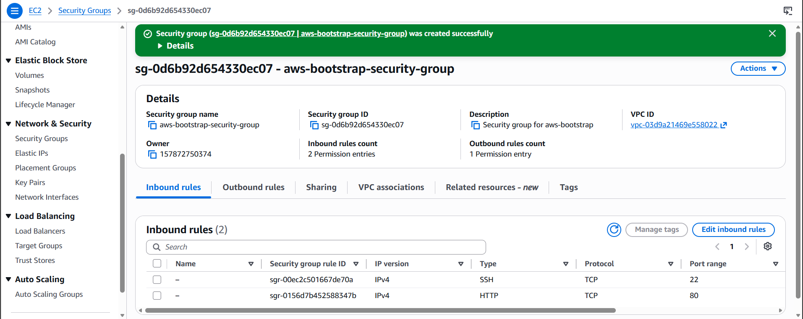
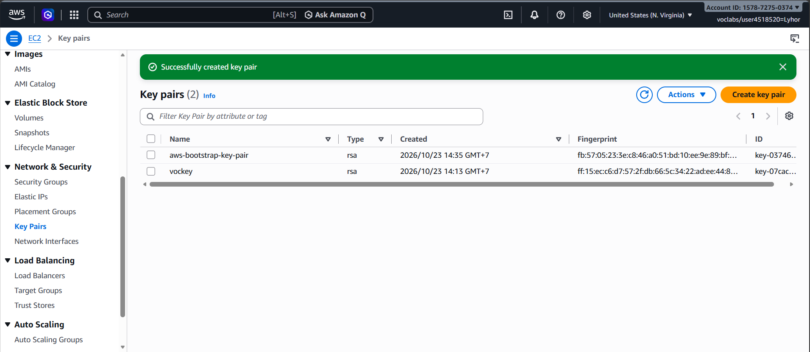
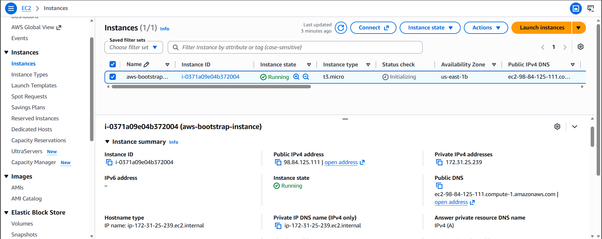
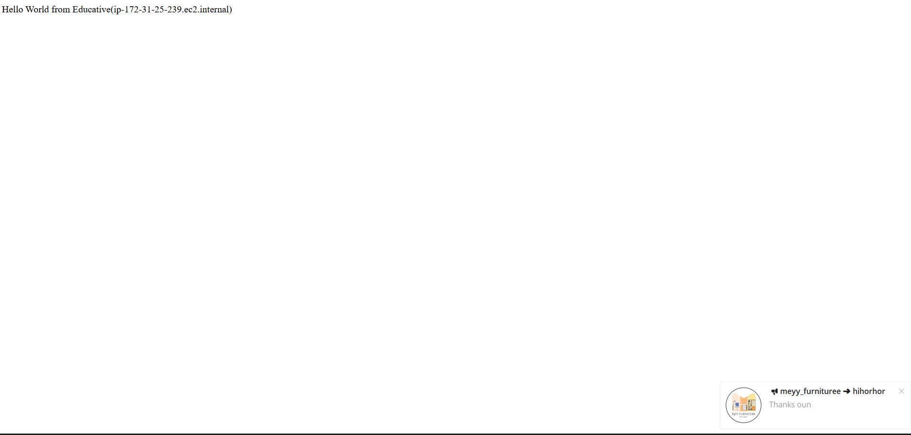
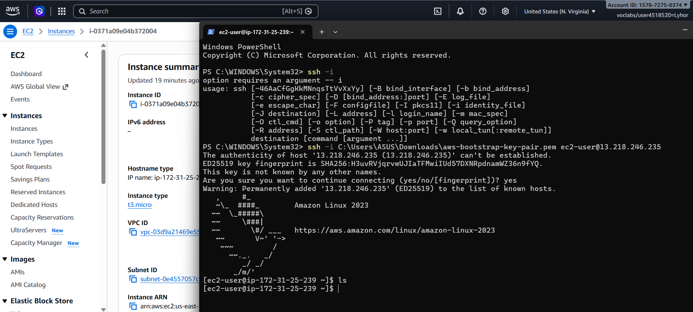
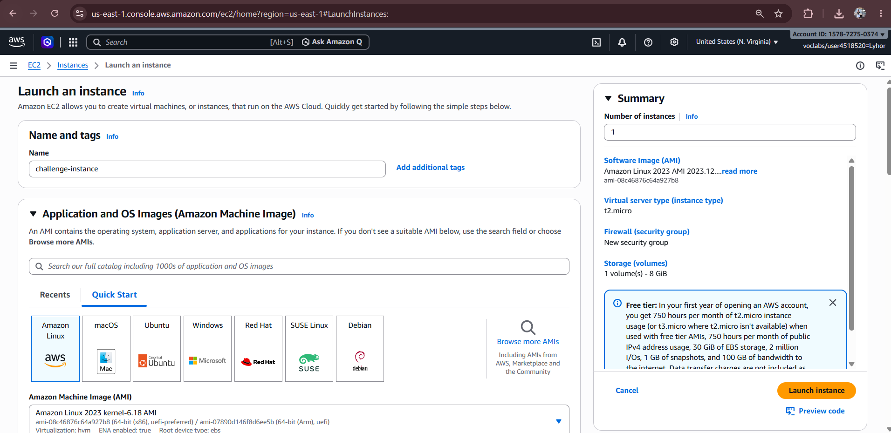
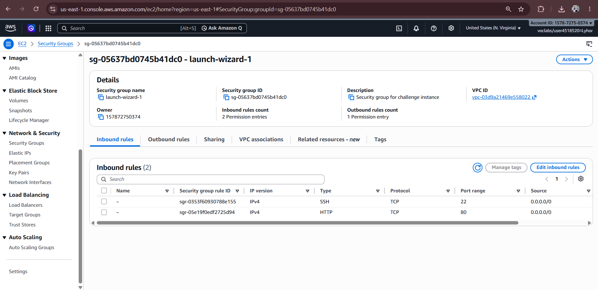
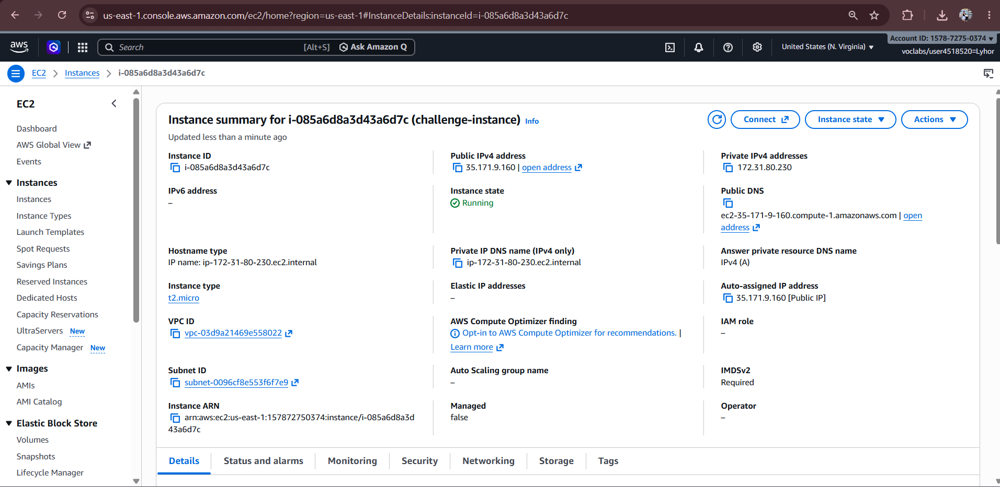
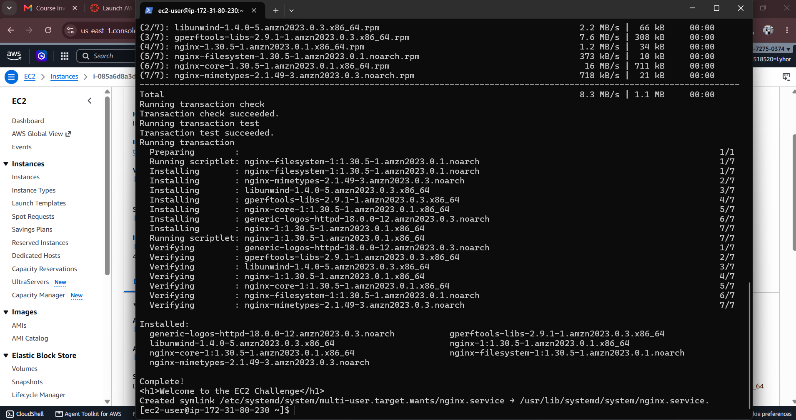
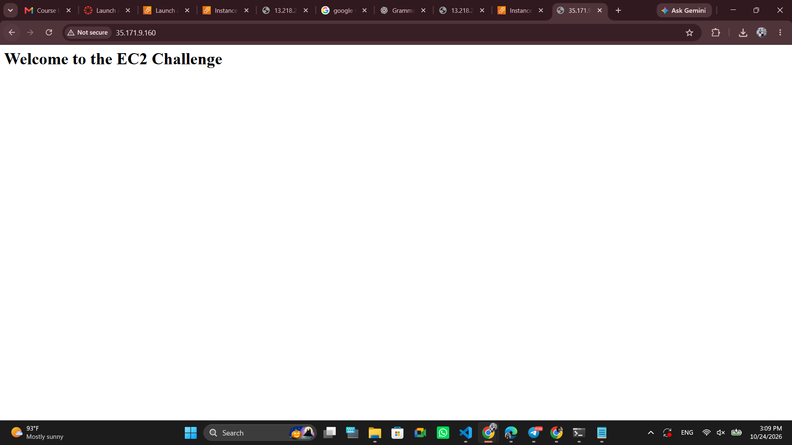

# Cloud Lab 1 Submission — Amazon EC2

Copy this template to `cc-lab-YOUR_ID/lab1/README.md` in your own repository. Follow [the instructions](lab1-instruction.md). Put your screenshots in `lab1/images/` with the file names below.

- **Student name: Luy Lyhor**
- **Student ID: e20220355**
- **Learner Lab user name: Lyhor**
- **Date completed: 10/24/26**

---

## Part 1.1 — An Amazon EC2 Walkthrough

### Security group



### Key pair



### Instance details



### Browser test



### SSH connection



Did you connect with your own SSH client or with EC2 Instance Connect?

Answer: I connected using my own SSH client. Specifically, I used Windows PowerShell on my local computer and ran the ssh -i command along with my downloaded .pem key pair file to connect to the instance's public IP address. I did not use the browser-based EC2 Instance Connect feature.

## Part 1.2 — EC2 Web Solution (Challenge)

### Launch configuration



### Security group



### Running instance



### Commands on the instance



Paste the commands you ran to install the web server and create `index.html`:

```bash
sudo dnf update -y
sudo dnf install nginx -y
echo "<h1>Welcome to the EC2 Challenge</h1>" | sudo tee /usr/share/nginx/html/index.html
sudo systemctl enable nginx
sudo systemctl start nginx
```

### Browser test



---

## Questions

1. Your security group has an SSH rule and an HTTP rule. What does each one let you do? What would stop working if you deleted the HTTP rule?

Answer:

- SSH rule (Port 22): This allows secure, encrypted command-line access to the instance. It lets me connect remotely using a terminal (like PowerShell) to manage the server.
- HTTP rule (Port 80): This allows standard, unencrypted web traffic to reach the instance. It lets web browsers access the website hosted on the server.
- If the HTTP rule was deleted: The website would stop loading in the browser (it would show a "connection timed out" error) because the firewall would block incoming web requests. However, I would still be able to connect to the server via SSH.

2. In Part 1.1 you never logged in to install the web server. What installed it, and when did it run?

Answer:

- The web server was installed by the User data script (the bash script starting with #!/bin/bash that I pasted into the "Advanced details" section).
- It ran automatically in the background during the very first boot of the EC2 instance, right after I clicked "Launch instance".

3. Why does the web page open with `http://` but not with `https://`?

Answer: It opens with http:// because our security group only has an inbound rule allowing traffic on Port 80 (HTTP). It does not have a rule allowing Port 443 (HTTPS). Additionally, we did not install or configure an SSL/TLS certificate on the Apache server, so it is only set up to serve unencrypted web traffic.

4. Part 1.2 asked for a 10 GiB root volume. Where in the launch settings did you set it, and how can you check the size on the running instance?

Answer:

- Where to set it: I set it in the "Configure storage" section at the bottom of the "Launch instance" page by changing the "Size (GiB)" value from the default (usually 8 GiB) to 10 GiB.
- How to check it:
  . In the AWS Console: I can go to the instance's Details tab and look under the "Storage" section to see the volume size.
  . Via SSH: I can connect to the instance and run the command lsblk or df -h in the terminal, which will display the actual disk partitions and their sizes.

## Problems and how I solved them (optional)

## AI note (optional)

One suggestion an AI tool gave you and how you checked it.

## Clean up

- [x] Part 1.1: instance terminated, key pair and security group deleted.
- [x] Part 1.2: instance terminated, security group (and key pair, if any) deleted.
