# Cloud Lab 2 Submission — Load Balancer and Auto Scaling

Copy this template to `cc-lab-YOUR_ID/lab2/README.md` in your own repository. Follow [the instructions](lab2-instruction.md). Put your screenshots in `lab2/images/` with the file names below.

- **Student name: Luy Lyhor**
- **Student ID: e20220355**
- **Learner Lab user name: Lyhor**
- **Date completed: 29/10/2026**

---

## Security groups

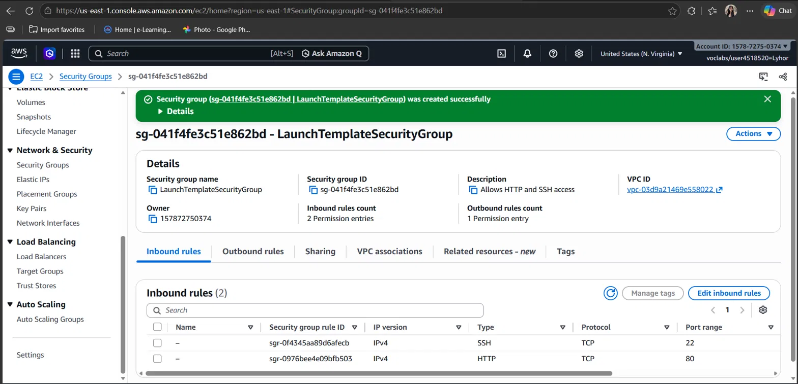

## Target group

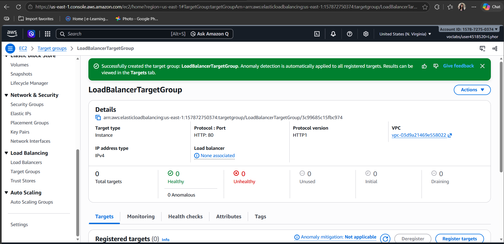

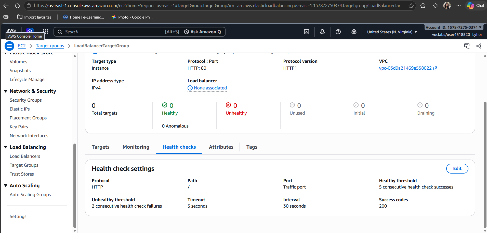

## Application Load Balancer

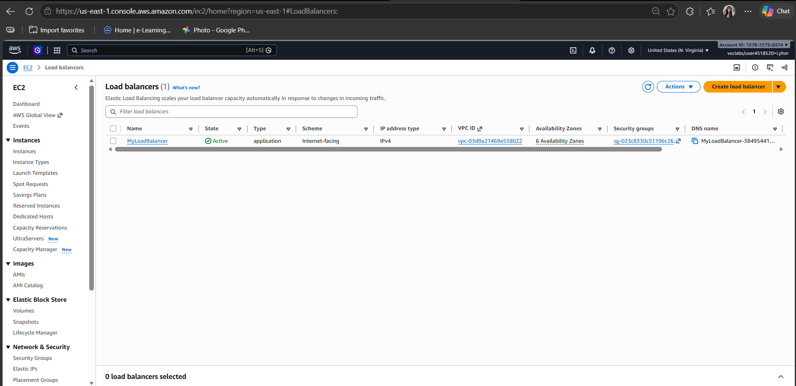

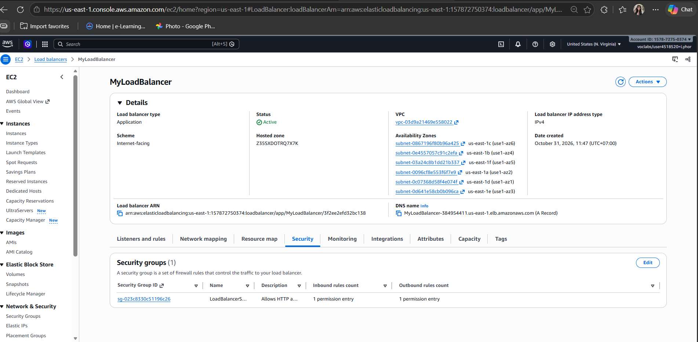

## Launch template

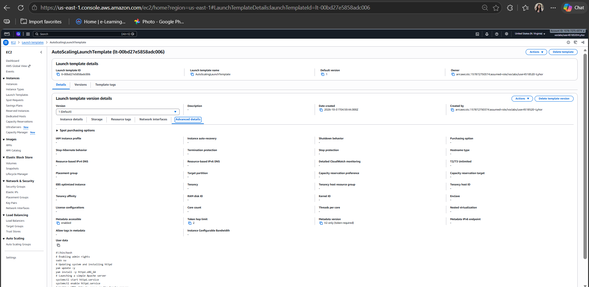

## Auto Scaling group

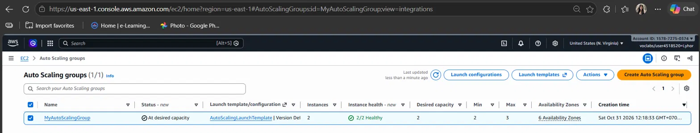

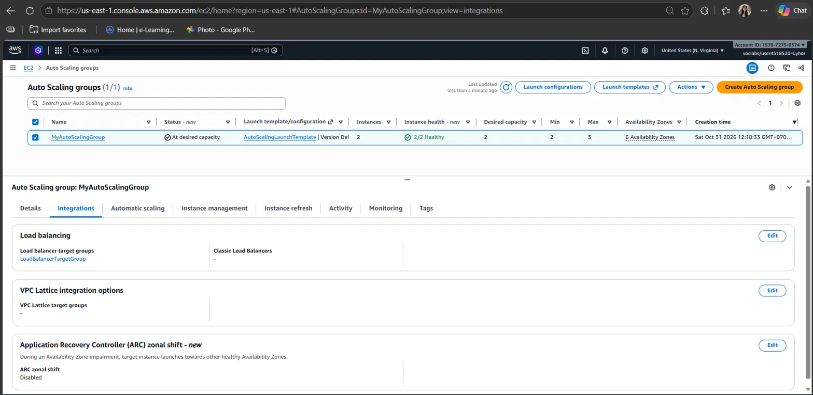

## Load balancing test

## Simulated application failure

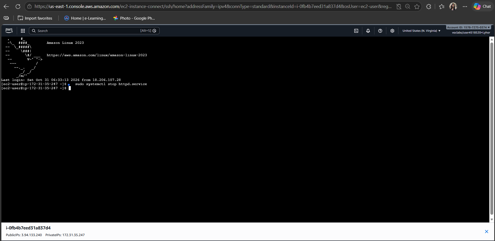

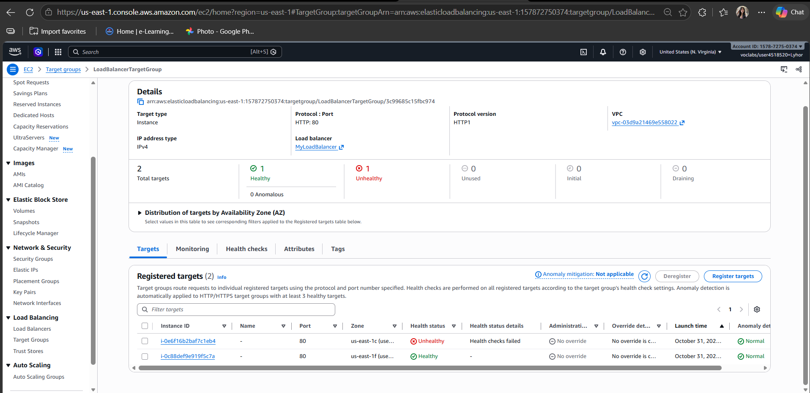

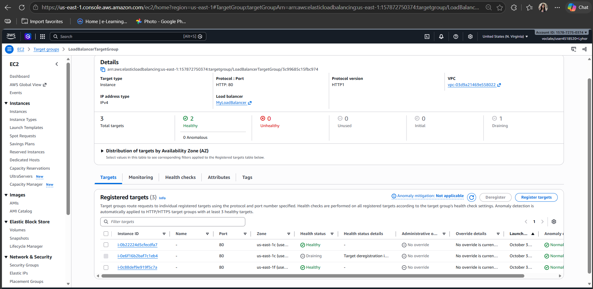

About how many minutes passed between stopping `httpd` and the new instance becoming healthy?

Answer: it was 5 minute

---

## Questions

## Questions

### 1. Why does the page show a different host name when you refresh it?

The browser does not connect to an instance directly. It connects to the DNS name of `MyLoadBalancer`. The Application Load Balancer sends each new request to one of the **healthy** targets registered in `LoadBalancerTargetGroup`, spreading the requests across them (round robin by default).

The Auto Scaling group runs two instances, and each one shows its **own** host name on the page. When I refresh, the request can go to the other instance, so a different host name appears. This shows that the load balancer is sharing the traffic between both instances.

### 2. Why was the instance unhealthy even though it was still running?

"Running" in EC2 only means the virtual machine is switched on. It says nothing about the web application.

The target group's health check sends an **HTTP request to each instance on port 80** (path `/`) every few seconds and expects a **success response (HTTP 200)**.

When I stopped `httpd`, the web server process ended, so nothing was listening on port 80. The health check requests failed (connection refused / no response). After several failed checks in a row (the unhealthy threshold), the target group marked the instance **unhealthy**, and the load balancer stopped sending traffic to it.

### 3. Who replaced the failed instance?

The **Auto Scaling group** replaced it. Each component has a different job:

- **Load balancer (`MyLoadBalancer`):** receives requests from users and forwards them **only to healthy targets**. It does not create or delete instances.
- **Target group (`LoadBalancerTargetGroup`):** holds the list of targets and **runs the health checks**. It decides which targets are healthy or unhealthy, but it cannot replace them.
- **Auto Scaling group (`MyAutoScalingGroup`):** manages the **number of instances**. Its health check type was set to use the load balancer (ELB) health checks, so when the target group reported the instance unhealthy, the Auto Scaling group **terminated it and launched a new one** from `AutoScalingLaunchTemplate` to keep the desired capacity of 2. The new instance was registered in the target group automatically and became healthy after passing the health checks.

### 4. How many instances run normally? When could there be 3?

Normally **2 instances** run, because the Auto Scaling group always tries to match the **desired capacity** (2). The **minimum** (2) means it will never go below 2, and the **maximum** (3) is the upper limit.

There could be **3** instances when:
- a **scaling policy** increases capacity because of high load (for example, high CPU use or many requests per target), so the group adds one instance, up to the maximum of 3; or
- someone **manually raises** the desired capacity to 3; or
- briefly during a **replacement or instance refresh**, when a new instance is launched before the old one has finished terminating.

### 5. How to allow HTTP only from the load balancer

Change the inbound rule of the instances' security group (`LaunchTemplateSecurityGroup`):

1. **Remove** the rule: HTTP, port 80, source `0.0.0.0/0` (anywhere).
2. **Add** a rule: HTTP, port 80, source = **the load balancer's security group** (`LoadBalancerSecurityGroup`, using its `sg-...` ID) instead of an IP range.

With this rule, only traffic coming from resources that use `LoadBalancerSecurityGroup` (the ALB) can reach the instances on port 80. Users on the internet can still open the website, but only **through the load balancer**. They can no longer connect to an instance's IP directly. The load balancer's own security group keeps allowing HTTP from `0.0.0.0/0`.