# Cloud Lab 2 Submission — Load Balancer and Auto Scaling

- **Student name:**
- **Student ID:**
- **Learner Lab user name:**
- **Date completed:**

---

## Security groups

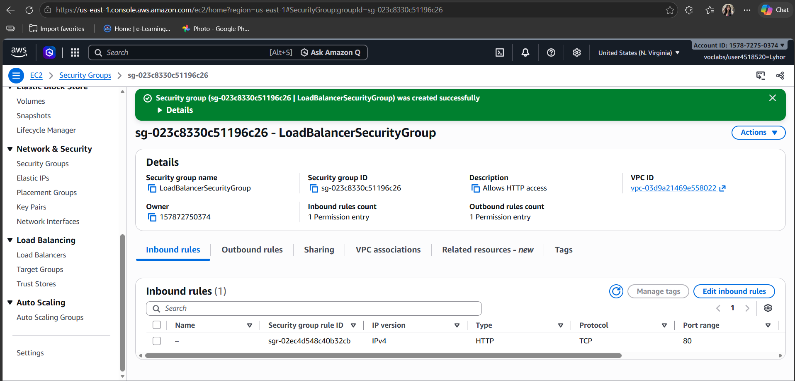

## Target group

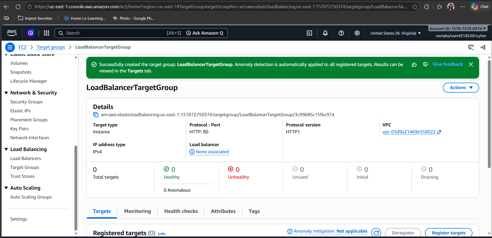

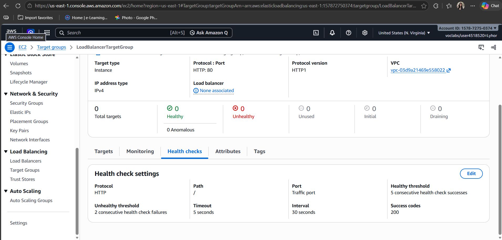

## Application Load Balancer

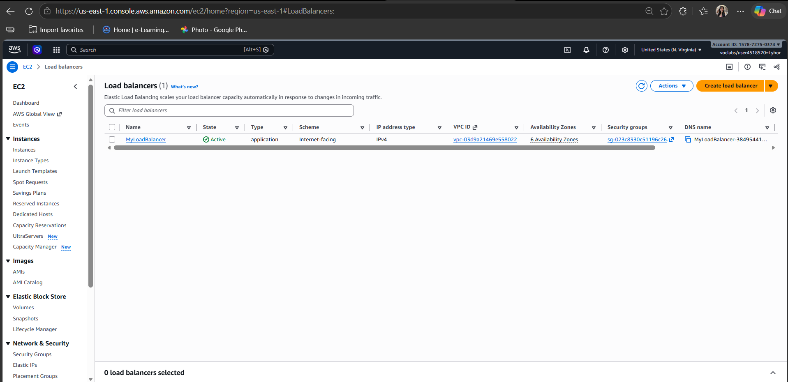

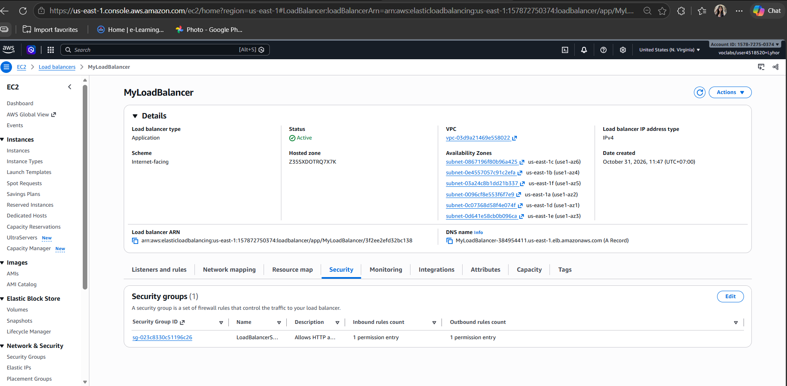

## Launch template

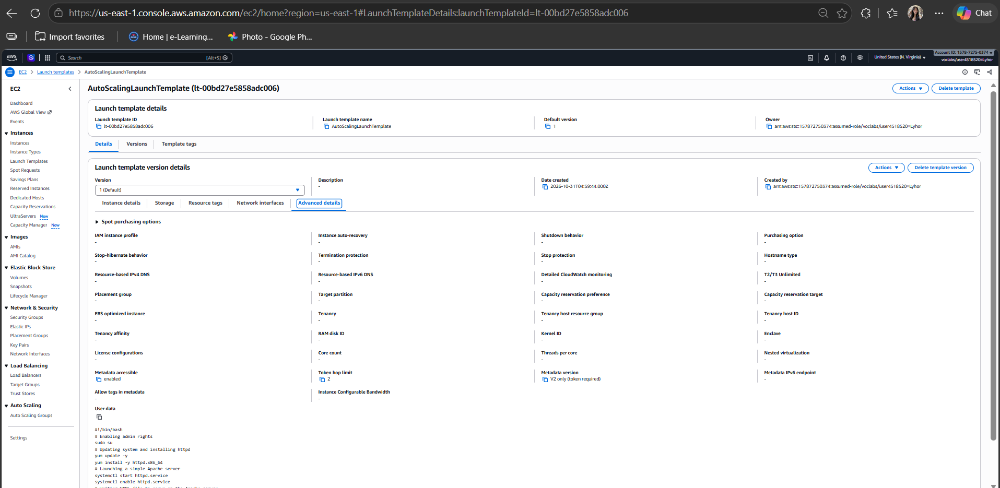

## Auto Scaling group

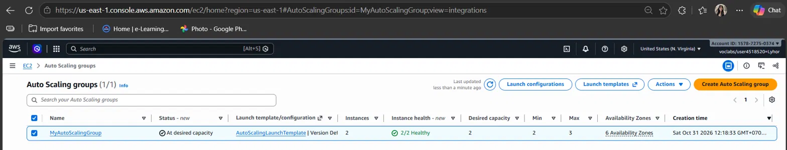

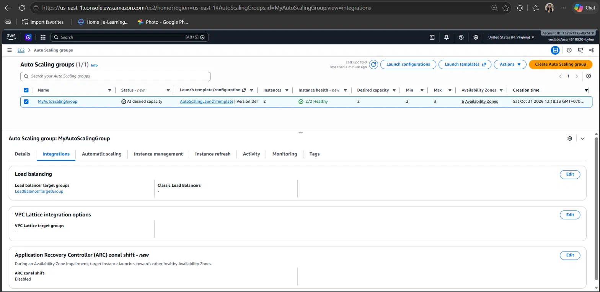

## Load balancing test

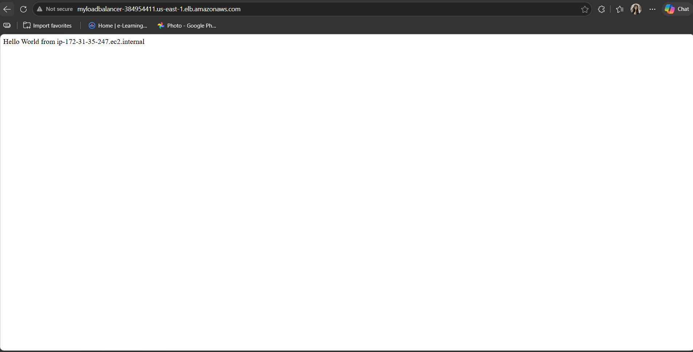

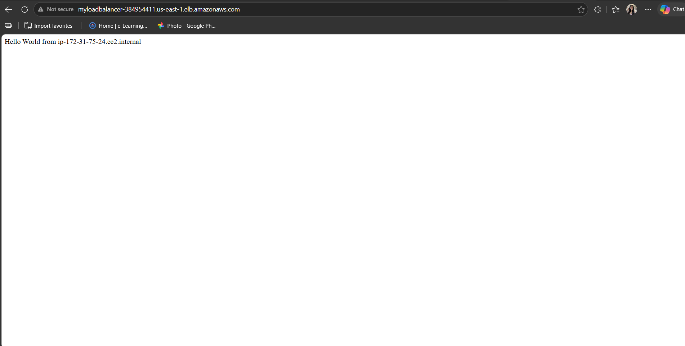

## Simulated application failure

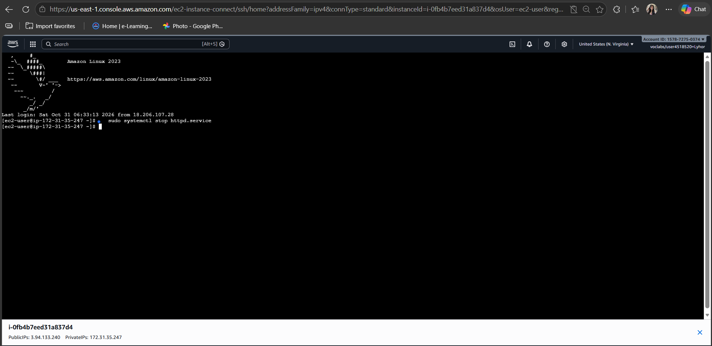

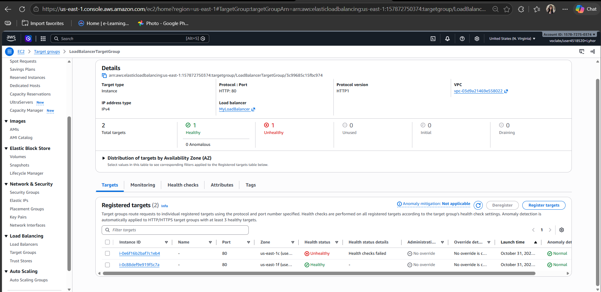

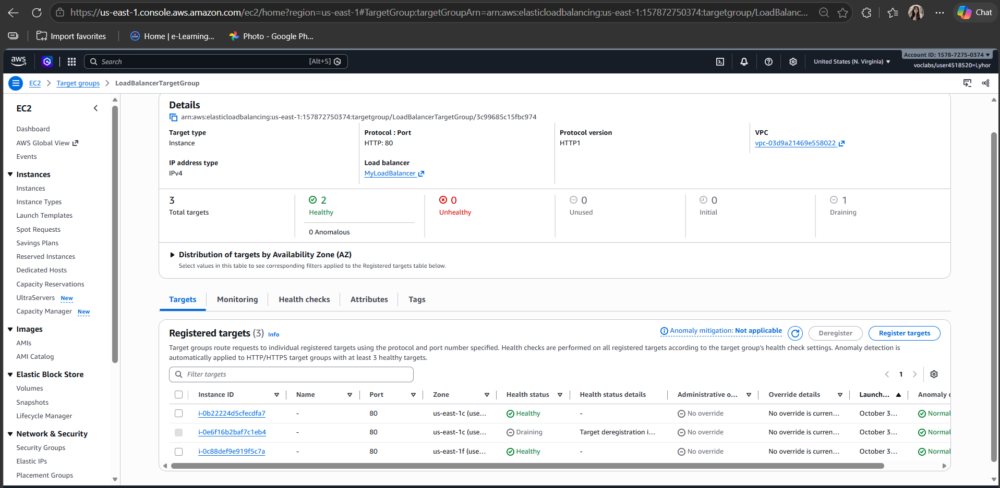

About how many minutes passed between stopping `httpd` and the new instance becoming healthy?

## Answer: Around 6 minutes

## Questions

## Questions

**1. Why does the page show a different host name when you refresh it?**
The Application Load Balancer spreads incoming requests across all healthy targets in the target group (round robin by default). Each refresh is a new request, so it can be sent to a different instance. Each instance's page shows its own host name (`hostname -f`), so the name changes depending on which instance answered.

**2. After you stopped `httpd`, the instance was still running in EC2, but the target group marked it unhealthy. What did the health check test, and why did the instance fail it?**
The target group's health check sends an HTTP request to path `/` on port 80 every 30 seconds and expects a `200` response. EC2 status checks only test the virtual machine and its hardware, so they still passed. After `httpd` was stopped, nothing was listening on port 80, so the health check got no valid response. After 2 consecutive failures (the unhealthy threshold), the target was marked unhealthy.

**3. Who replaced the failed instance: the load balancer, the target group, or the Auto Scaling group? Explain the role of each one.**
The **Auto Scaling group** replaced it.

- **Load balancer:** receives traffic from users on its listener (HTTP:80) and forwards it to the target group.
- **Target group:** holds the list of instances (targets), runs the health checks, and only sends traffic to healthy targets.
- **Auto Scaling group:** keeps the number of instances at the desired capacity. Because ELB health checks were turned on, it saw the target was unhealthy, terminated that instance and launched a new one from the launch template.

**4. With desired 2, minimum 2 and maximum 3, how many instances run normally? In what situation could there be 3?**
Normally **2** instances run (the desired capacity). There could be 3 if the desired capacity is raised, for example by a scaling policy when load is high (such as high CPU) or by changing it manually. It can also briefly happen during a replacement, when a new instance is launched before the old one is fully terminated. It can never go above the maximum of 3.

**5. The instances' security group allows HTTP from anywhere. How could you change it so that the instances accept HTTP only from the load balancer?**
Edit the inbound HTTP (port 80) rule of `LaunchTemplateSecurityGroup` and change its source from `0.0.0.0/0` to the load balancer's security group, `LoadBalancerSecurityGroup`. Then only traffic coming through the load balancer can reach the instances on port 80. Users can still open the site through the load balancer's DNS name, but not by going to the instances' public IPs directly.

## Problems and how I solved them (optional)

## AI note (optional)

One suggestion an AI tool gave you and how you checked it.

## Clean up

- [x] `MyAutoScalingGroup` deleted and its instances terminated.
- [x] `AutoScalingLaunchTemplate` deleted.
- [x] `MyLoadBalancer` and `LoadBalancerTargetGroup` deleted.
- [x] Both security groups deleted.
