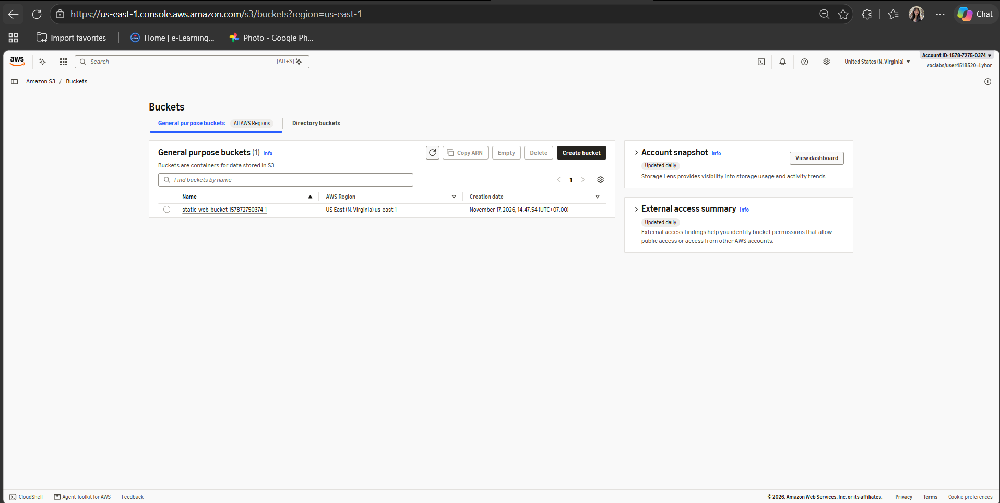
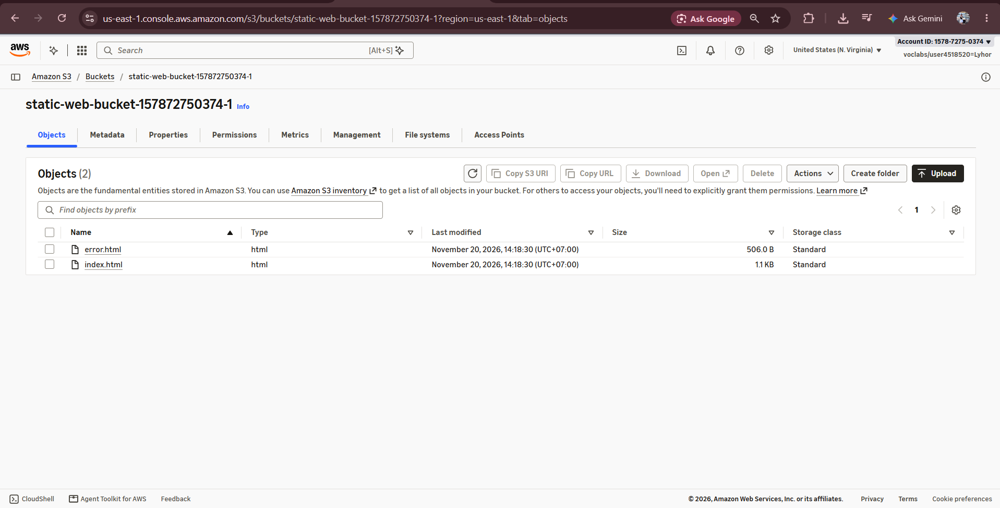
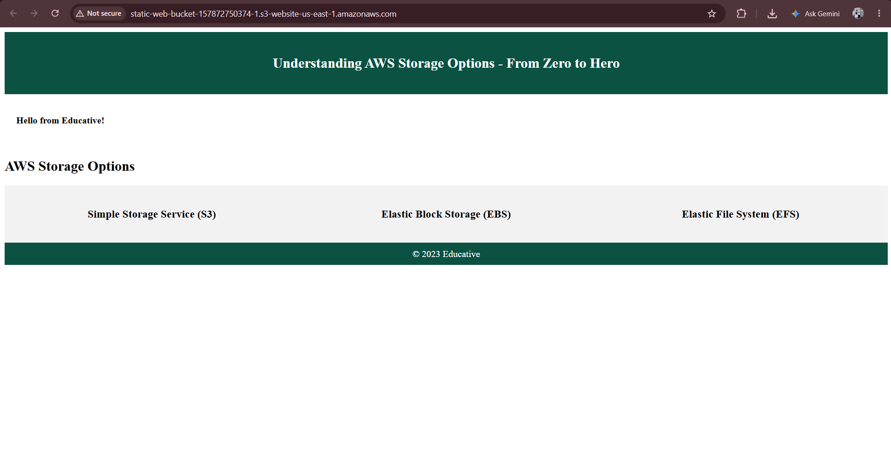
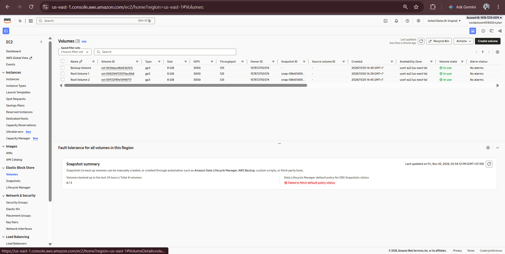
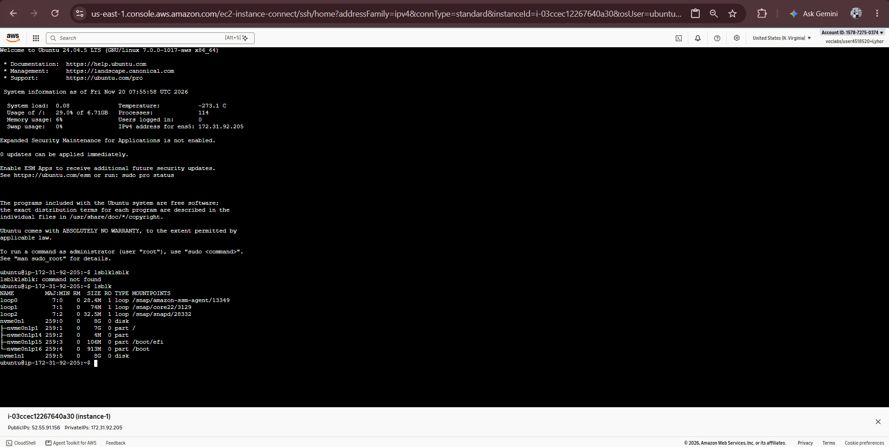
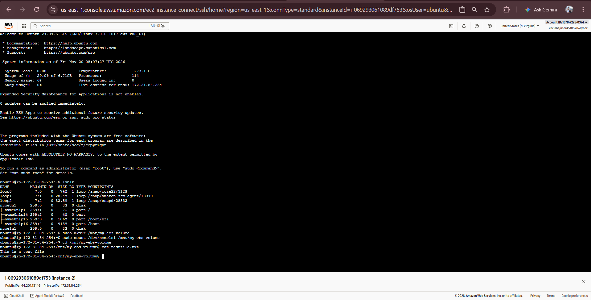
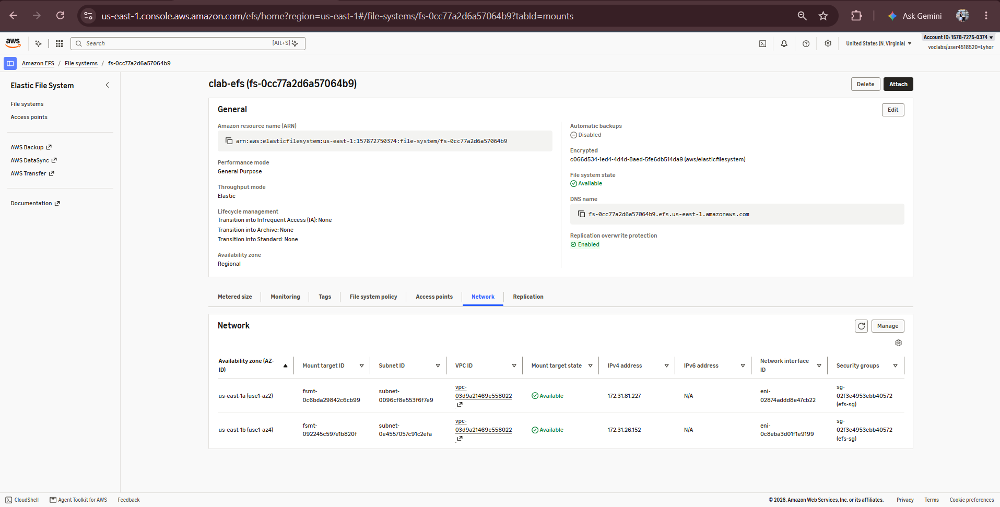
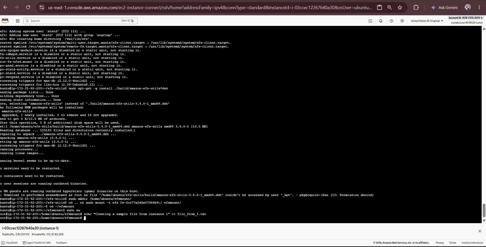
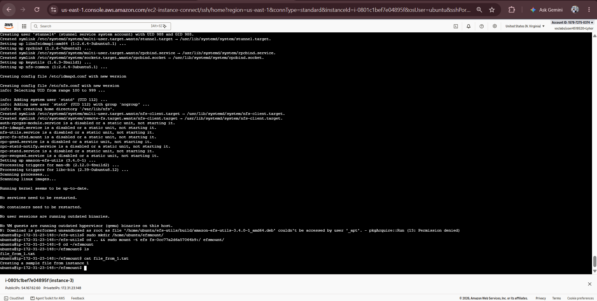

# Cloud Lab 3 Submission — AWS Storage Options

Copy this template to `cc-lab-YOUR_ID/lab3/README.md` in your own repository. Follow [the instructions](lab3-instruction.md). Put your screenshots in `lab3/images/` with the file names below.

- **Student name: Luy Lyhor**
- **Student ID: e20220355**
- **Learner Lab user name: Lyhor**
- **Date completed: 20/11/2026**

---

## Part 2.1 — Amazon S3

### Bucket list

### Uploaded files

### Static website

---

## Part 2.2 — Amazon EBS

### Volumes page

### Attached volume (`lsblk`)

Which device name did your volume get (`xvdf`, `nvme1n1`, ...)?

### File read on instance-2

---

## Part 2.3 — Amazon EFS

### File system and mount targets

### File created on instance-1

### File listed on instance-3

---

## Questions

**1. After you turned on static website hosting, the endpoint first answered 403 Forbidden. Why, and what changed after you added the bucket policy?**

Turning on static website hosting only gives the bucket a website endpoint. It does not give anyone permission to read the objects. S3 buckets and objects are private by default, and turning off Block Public Access only *allows* public access, it does not *grant* it. So the endpoint answered 403 Forbidden. After I added the bucket policy with `"Effect": "Allow"`, `"Principal": "*"` and `"Action": "s3:GetObject"` on `<bucket-arn>/*`, everyone was allowed to read every object in the bucket, so the browser could load `index.html`.

**2. `testfile.txt` was still there after you moved Backup Volume to `instance-2`. What would have happened to a file saved on `instance-1`'s root volume after terminating `instance-1`?**

The file would have been lost. The root volume is created at launch with "Delete on termination" turned on by default, so AWS deletes it when the instance is terminated. Backup Volume was an *additional* EBS volume. Additional volumes persist independently of the instance, which is why `testfile.txt` survived and could be read on `instance-2`.

**3. Why did you run `mkfs` on `instance-1` but not on `instance-2`?**

The new EBS volume was raw, unformatted block storage, so on `instance-1` I had to create an ext4 file system with `mkfs` before I could mount it and save files. When I attached the same volume to `instance-2`, it already had that file system and `testfile.txt` on it. Running `mkfs` again would have created a new empty file system and erased the data, so I only mounted it.

**4. Why could `instance-1` and `instance-3` use the EFS file system at the same time, when an EBS volume had to be detached first? Why did they have to be in the subnets of the mount targets?**

EFS is a network file system (NFS). Many instances connect to it over the network at the same time, and EFS manages the shared access. An EBS volume is a block device that works like a hard disk attached to one instance. A standard gp3 volume can only be attached to one instance at a time, so I had to unmount and detach it from `instance-1` before attaching it to `instance-2`.

The instances connect to EFS through a mount target, which is a network interface with an IP address in one subnet and Availability Zone. The EFS DNS name points each instance to the mount target in its own Availability Zone. `instance-1` is in us-east-1a and `instance-3` is in us-east-1b, so each needed a mount target in its subnet. The security group `efs-sg` also had to allow NFS (TCP 2049) from `ec2instances-sg`.

**5. For each need, choose S3, EBS or EFS and give one reason.**

| Need | Choice | Reason |
|---|---|---|
| (a) A website's images | **S3** | Each image is an object with its own URL, storage scales without limit, and it costs less than disk storage, so it's ideal for static files served to browsers. |
| (b) The disk of a database server | **EBS** | A database needs fast, low-latency block storage attached directly to its server, like a local hard disk, and the data persists even if the instance is stopped or replaced. |
| (c) A folder shared by several web servers | **EFS** | Many EC2 instances, even in different Availability Zones, can mount the same file system at the same time and see the same files. |
## Problems and how I solved them (optional)

## AI note (optional)

One suggestion an AI tool gave you and how you checked it.

## Clean up

- [ ] Instances `instance-1`, `instance-2`, `instance-3` terminated.
- [ ] `clab-efs` and **Backup Volume** deleted.
- [ ] Security groups `efs-sg` and `ec2instances-sg` deleted.
- [ ] S3 bucket emptied and deleted.