# Cloud Lab 4 Submission — Amazon VPC

- **Student name: Luy Lyhor**
- **Student ID: e20220355**
- **Learner Lab user name: Lyhor**
- **Date completed: 09/11/2026**

---

## VPC and internet gateway

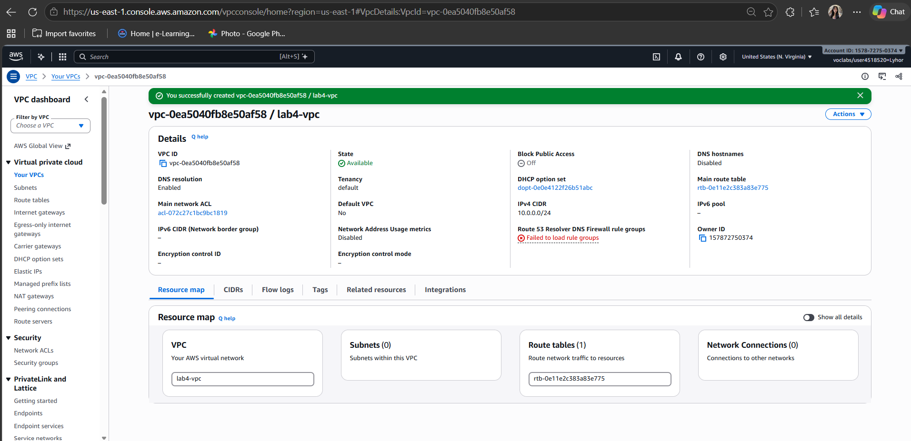

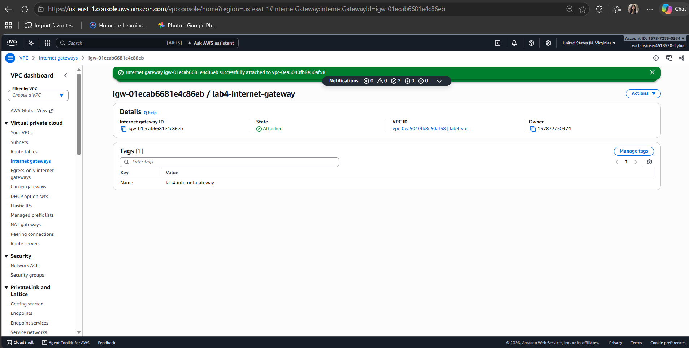

## Public subnet

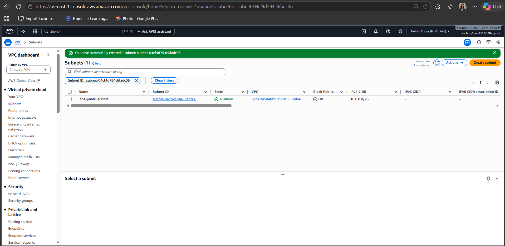

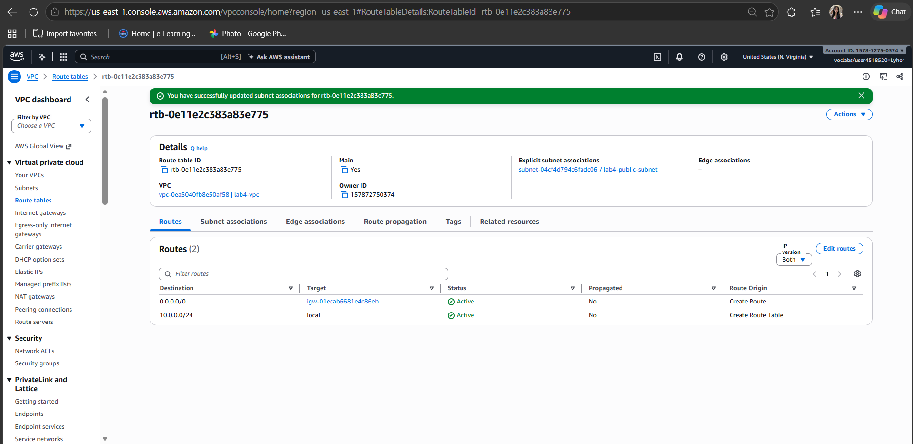

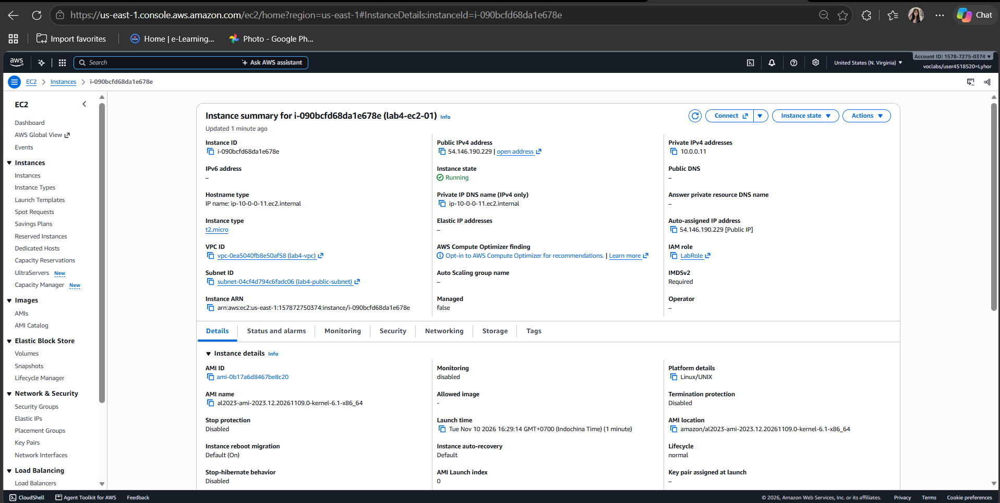

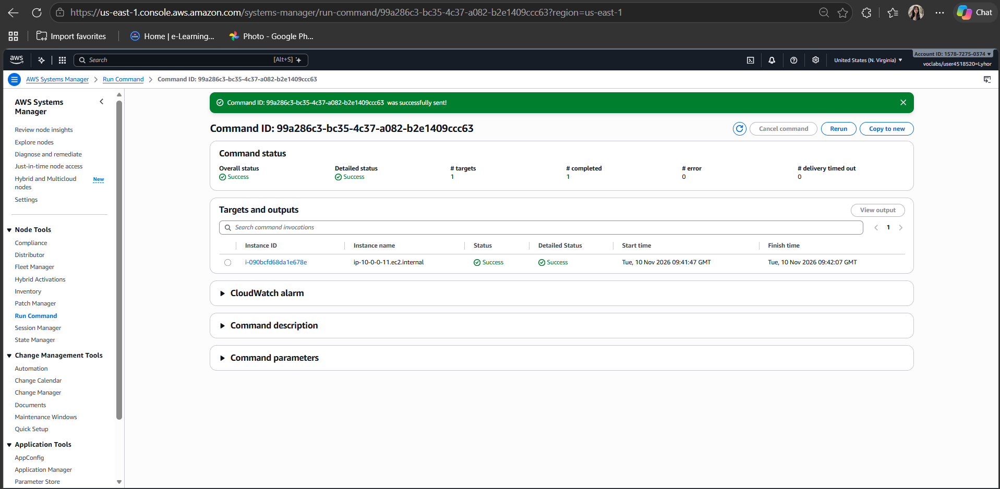

## Private subnet

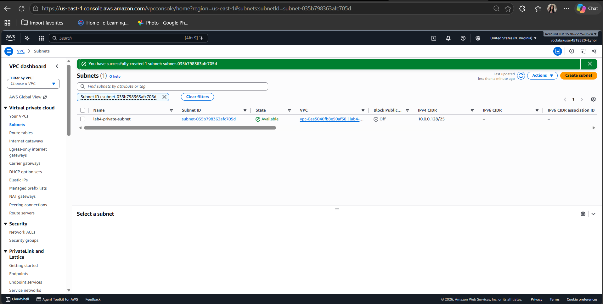

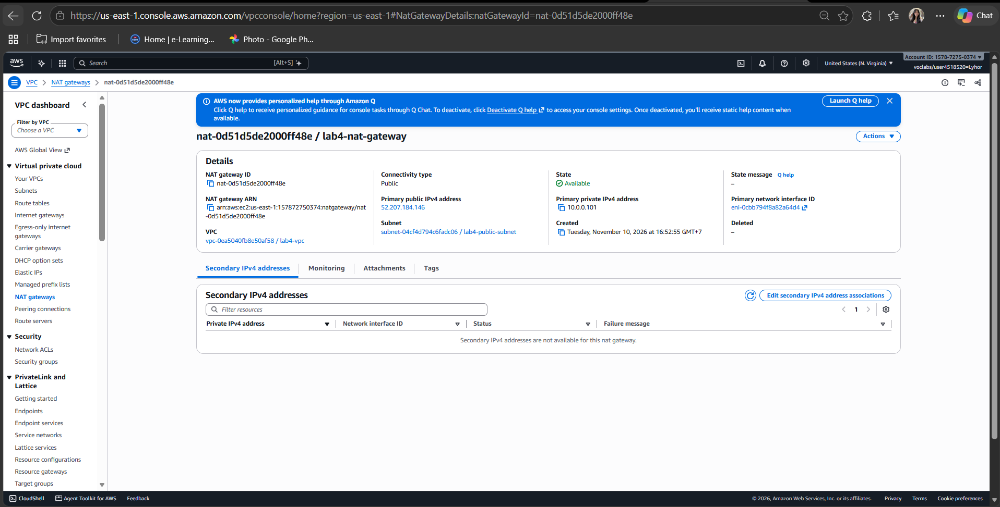

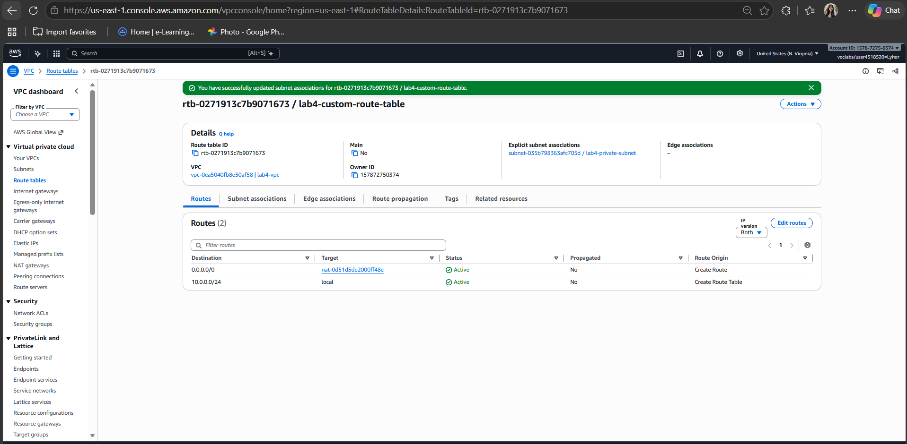

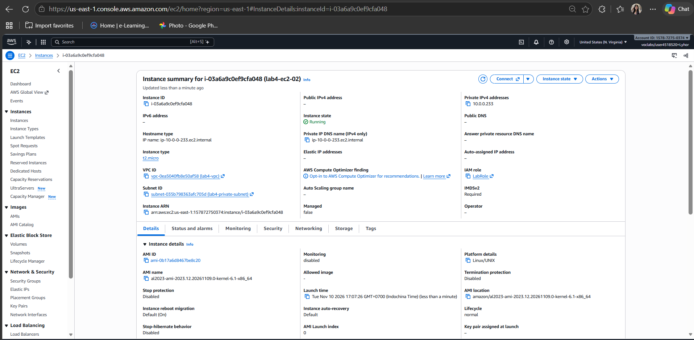

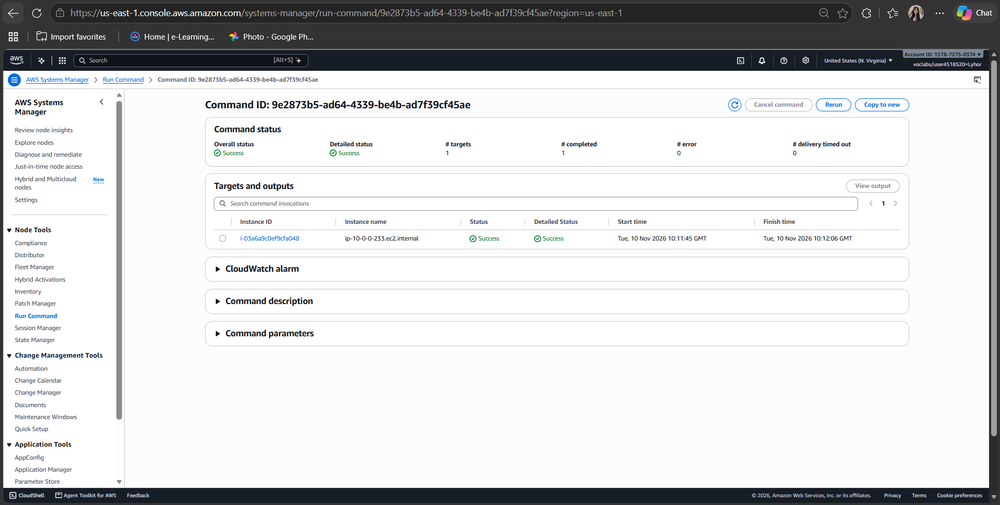

---

## Questions

### 1. IP addresses in each block, and why the subnets do not overlap

The number after the `/` is how many bits are fixed for the network. An IPv4 address has 32 bits, so the remaining bits are for hosts: number of addresses = 2^(32 − prefix).

| Block | Prefix | Addresses | Range |
|---|---|---|---|
| VPC `10.0.0.0/24` | /24 | 2^8 = **256** | 10.0.0.0 – 10.0.0.255 |
| Public subnet `10.0.0.0/25` | /25 | 2^7 = **128** | 10.0.0.0 – 10.0.0.127 |
| Private subnet `10.0.0.128/25` | /25 | 2^7 = **128** | 10.0.0.128 – 10.0.0.255 |

The two subnets do not overlap because the /24 is split exactly in half: the public subnet ends at `.127` and the private subnet starts at `.128`. Together they use all 256 addresses of the VPC, with no address in both.

In each subnet AWS reserves 5 addresses (network address, VPC router, DNS, one for future use, and broadcast), so only **123** are usable. The console showed "IP addresses available: 123" for both subnets.

### 2. What makes one subnet public and the other private

The difference is the **route table** each subnet is associated with. The subnets are otherwise configured the same way.

- `lab4-public-subnet` is associated with a route table that has `0.0.0.0/0 → lab4-internet-gateway`. Traffic to the internet goes directly through the internet gateway, and instances there can have a public IP. That makes the subnet **public**.
- `lab4-private-subnet` is associated with `lab4-custom-route-table`, which has `0.0.0.0/0 → lab4-nat-gateway`. It has **no route to the internet gateway**, so the internet cannot reach it directly. That makes the subnet **private**.

Both route tables also have `10.0.0.0/24 → local`, so instances in the two subnets can talk to each other with private IPs.

### 3. Why the NAT gateway is in the public subnet

The NAT gateway itself needs to reach the internet. It has a public Elastic IP (`52.207.184.146`), and it sends traffic out through the internet gateway. Only the public subnet has a route to the internet gateway.

If the NAT gateway were in the private subnet, its own traffic would follow the private route table (`0.0.0.0/0 → NAT gateway`), which points back to itself. It would have no path to the internet, so it could not forward anything.

The traffic path is: private instance → NAT gateway (public subnet) → internet gateway → internet.

### 4. Can the internet reach `lab4-ec2-02`? Can it download updates?

**Can someone on the internet open a connection to it? No.**
- It has no public IP address, only a private one (`10.0.0.233`), and private addresses cannot be routed on the internet.
- Its subnet has no route to the internet gateway.
- A NAT gateway only allows connections that are **started from inside**. It does not accept new incoming connections from the internet.
- In addition, its security group has no inbound rules.

**Can it download updates? Yes.**
The instance starts the connection itself. Its traffic goes to the NAT gateway, which replaces the private source IP with its own Elastic IP and sends the request out through the internet gateway. The reply comes back to the NAT gateway, which forwards it to the instance. Task 11 proved this: `sudo yum update -y` ran on `lab4-ec2-02` with status **Success**.

### 5. Why the instances needed `LabInstanceProfile` for Systems Manager

Systems Manager works through the **SSM Agent**, which is already installed on Amazon Linux. The agent connects **out** to the Systems Manager service to register the instance and receive commands. To call the AWS API, it needs AWS credentials.

`LabInstanceProfile` attaches the IAM role `LabRole` to the instance. The role gives the agent temporary credentials and the permissions it needs to talk to Systems Manager. Without an instance profile, the agent cannot authenticate. The instance would not appear in Run Command (it would not show as "Online"), and the test could not run.

This is also why the security groups did not need an SSH inbound rule. The connection is outgoing from the instance to AWS, not incoming. For `lab4-ec2-02`, that outgoing connection also went through the NAT gateway.