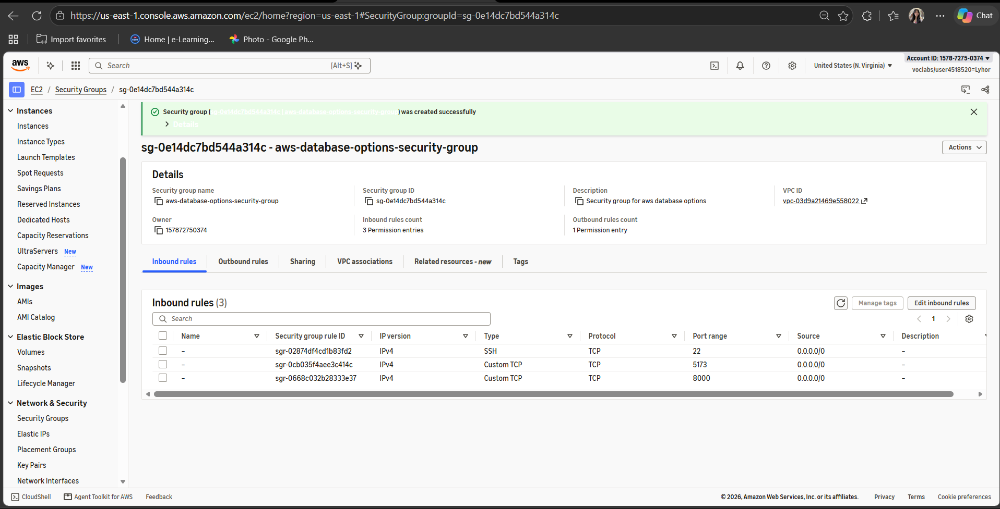
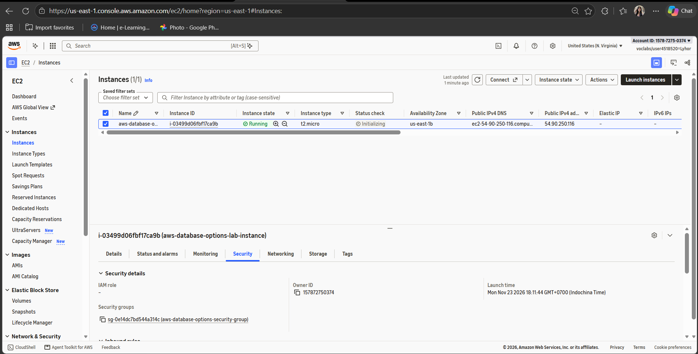
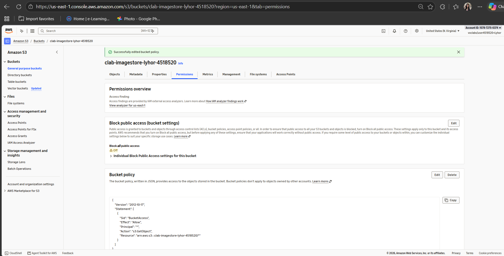
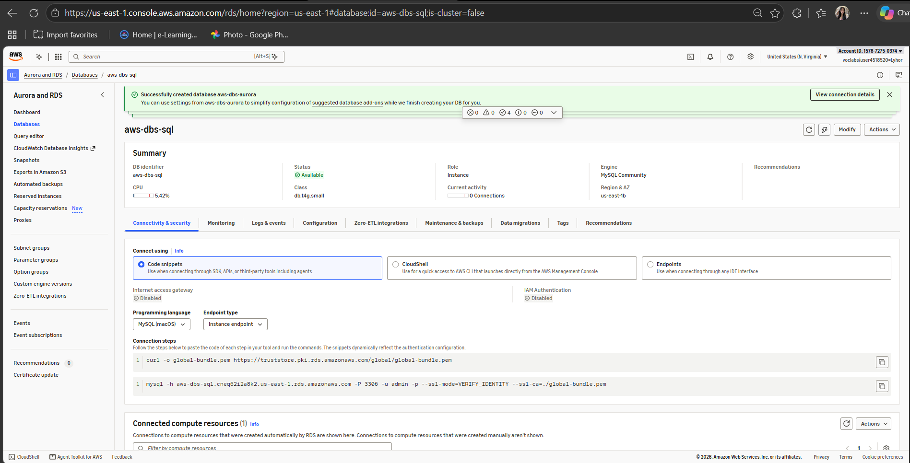
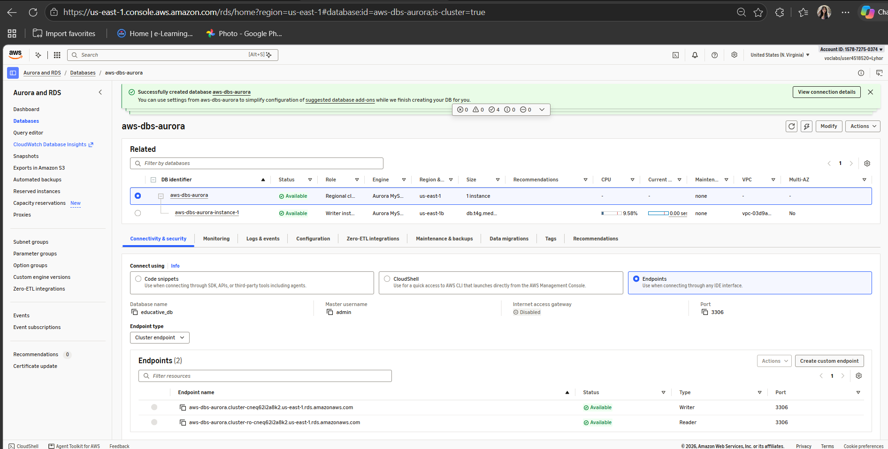
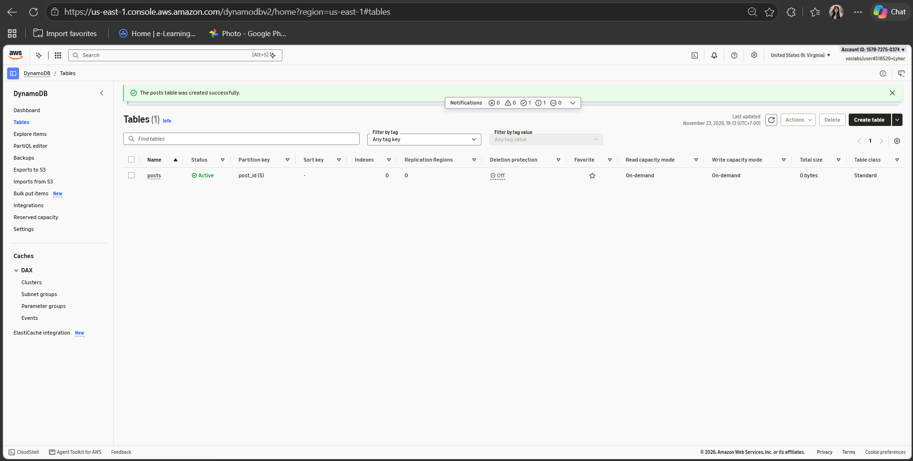
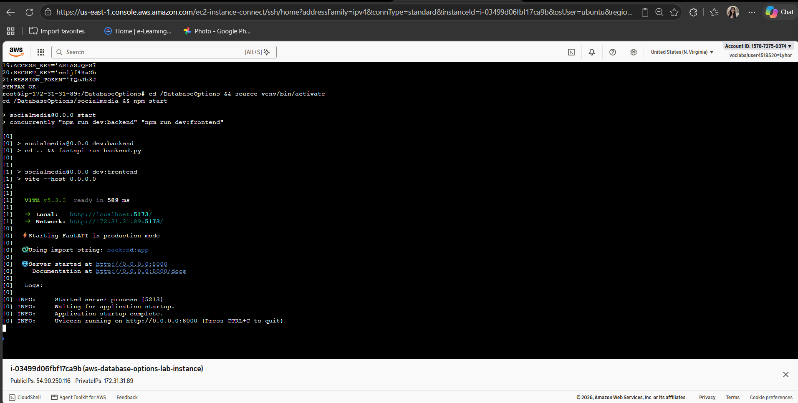
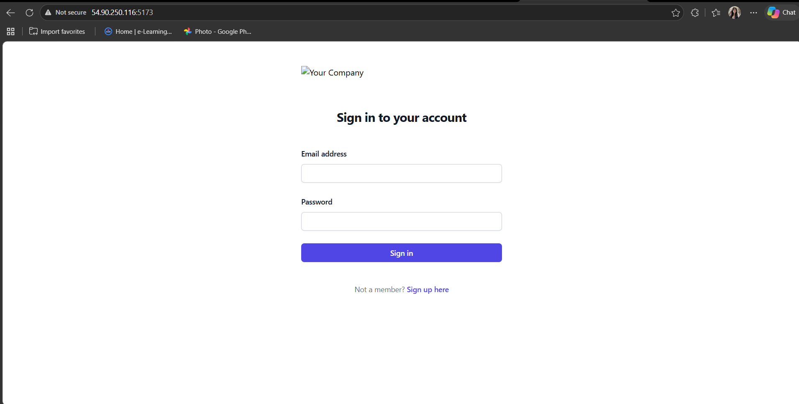
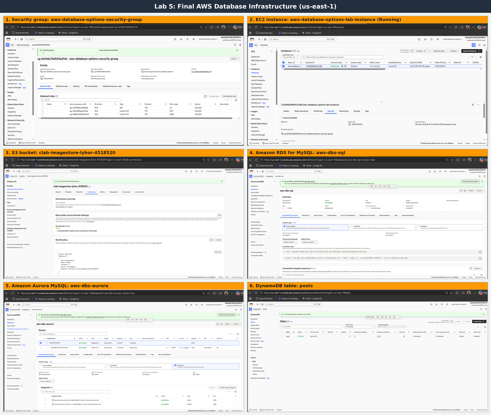
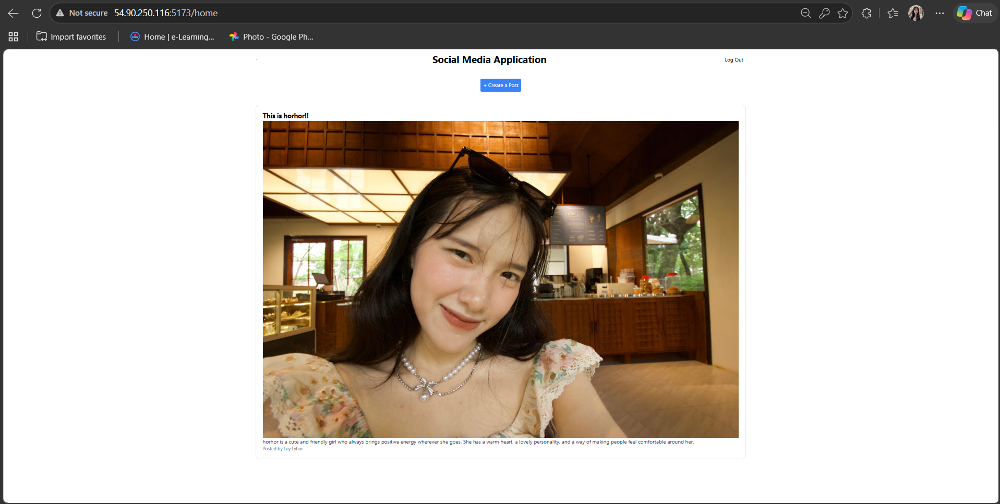

# Cloud Lab 5 Submission — AWS Database Lab

Copy this template to `cc-lab-YOUR_ID/lab5/README.md` in your student repository. Follow [the lab instructions](lab5-instruction.md) and save your screenshots in `lab5/images/` with the file names below. This report is the single document that holds all your screenshots. Each heading labels the screenshot under it.

- **Student name: Luy  Lyhor**
- **Student ID: e20220355**
- **Learner Lab user name: Lyhor**
- **Date completed: 23/11/2026**

## 1. Security Group Rules

`aws-database-options-security-group` with its inbound rules (SSH port 22, Custom TCP ports 8000 and 5173) and its outbound rule.

## 2. EC2 Instance Running

`aws-database-options-lab-instance` in the **Running** state with `aws-database-options-security-group` attached.

## 3. S3 Bucket

Your `clab-imagestore-…` bucket with its public access settings and bucket policy visible.

## 4. RDS DB Instance

`aws-dbo-sql` with the status **Available** and its endpoint visible.

## 5. Aurora DB Status

The `aws-dbo-aurora` cluster with the status **Available** and its writer and reader endpoints visible.

## 6. DynamoDB Table

The `posts` table with the status **Active** and its partition key `post_id` visible.

## 7. Application Configuration and Testing

The EC2 instance terminal after `npm start`, showing that the application started.

The application running in your browser at `http://<Public_IP_of_EC2>:5173`, with the address bar visible.

## 8. Final Infrastructure

One collage of the resources you created: EC2 instance, security group, RDS and Aurora databases, DynamoDB table and S3 bucket.

## Signup and Sample Post (optional)

The signup or login page and a sample post. Delete this section if you did not take this screenshot.

## Errors and troubleshooting (optional)

Screenshots of any error messages you met, and what you did about them.
 Answer: For me i don't have any errors.
---

## Questions

**1. Which instance answers the reader endpoint, and why does the app still work?**

The cluster has only one instance, `aws-dbs-aurora-instance-1`, which is the writer. The reader endpoint (`aws-dbs-aurora.cluster-ro-...`) normally load-balances across Aurora Replicas, but when there are no replicas, Aurora routes it to the writer instance. So both the writer endpoint and the reader endpoint point to the same instance. The app still works because login reads from the same database that signup wrote to, so there's no replication lag and a new user can log in immediately.

**2. What does each table store, and how does `/get_posts` join them?**

- `user_post` (RDS MySQL) stores the post's metadata: `id` (the post ID) and `username` (who wrote it).
- `posts` (DynamoDB) stores the post's content: `post_id` (partition key), `title`, `content` and the optional `media` URL pointing to the image in S3.

`/get_posts` runs `SELECT id, username FROM user_post` on RDS. Then, for each row, it calls `table.get_item(Key={'post_id': id})` on DynamoDB, adds the `username` to the item, and appends it to the result list. The join happens in Python code, not in SQL. It does one DynamoDB lookup per post, and if a post ID is missing in DynamoDB, it returns a 404 error.

**3. What happens with two posts in the same second, or at the same time on different days?**

The ID is `username + HH:MM:SS` and has no date, so in both cases the second post gets the **same ID** as the first. The code inserts into `user_post` first, and `id` is the PRIMARY KEY, so the second INSERT fails with a duplicate-key error. The API returns `500 "Error creating Post"` and the post is lost. If there were no SQL constraint, DynamoDB's `put_item` would silently **overwrite** the first post, because it has the same `post_id`. A safer ID would include the full date (e.g. `%Y%m%d%H%M%S%f`) or use a UUID.

**4. Why does the post content go into DynamoDB instead of SQL?**

According to the lab's database design, post data can vary from post to post: some posts have fields that others don't (for example, `media` is optional). DynamoDB is a schemaless NoSQL database, so each item can have different attributes without needing NULL columns or schema changes. It also gives fast, scalable lookups by `post_id`. User data, on the other hand, is structured and the same for every user, so it stays in SQL.

**5. One risk of plaintext passwords and one risk of a public S3 bucket.**

- **Plaintext passwords:** anyone who gets access to the `users` table (a leaked backup, a stolen DB password, an admin, or an attacker) can read every user's password directly. Since people reuse passwords, this can also compromise their other accounts. Passwords should be stored as salted hashes (e.g. bcrypt or Argon2).
- **Public S3 bucket:** anyone who has or guesses an object's URL can view or download the uploaded files, including private photos, without logging in. The URLs are predictable (`posts/<username><time>/<filename>`), so files could be found by guessing. Private objects with pre-signed URLs would be safer.

